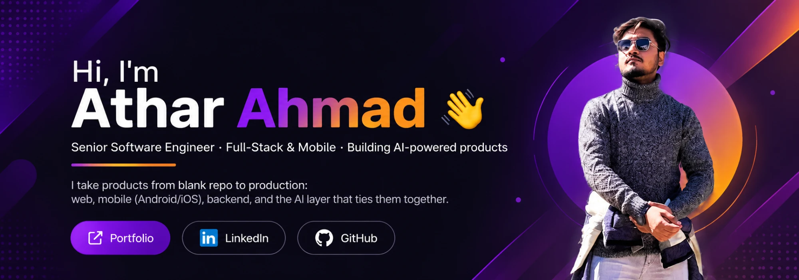

<div align="center">

<a href="https://atharggg.netlify.app/"></a>

[](https://atharggg.netlify.app/)
[](https://www.linkedin.com/in/athar-ahmad-5658611b7/)
[](https://github.com/Athar9909)

</div>

---

## 🧭 At a glance

- 🤖 **AI in production, not demos.** I build real-time voice AI agents ([ShivAI](https://callshivai.com), 1M+ conversations) and ship LLM features that act on real data: tool-calling assistants, multilingual voice (TTS) and guardrailed bots.
- 📱 **Ship to the stores.** I maintain a React Native app on Google Play end to end: releases, Android 16 / API 36 targeting, 16 KB page-size compliance, Firebase Crashlytics and Performance.
- 🧱 **Full-stack ownership.** React + TypeScript frontends, Node/Express + MongoDB backends, deployed on Vercel and Render.
- 🔐 **Fintech & KYC.** Native Kotlin / Jetpack Compose: ID-card OCR, face match, liveness checks, biometrics and Stripe payments.
- ⚡ **Fast and steady.** Small, focused commits, written delivery plans and API contracts, and features shipped weekly.

---

## 🚀 Featured work

### 📞 ShivAI: voice AI employee for businesses
**React · TypeScript · Real-time Voice AI** · [callshivai.com](https://callshivai.com)

ShivAI is an AI employee that answers calls and sells, supports and books appointments 24/7, in **50+ languages**. It has powered **1M+ conversations** across **100+ industries**. I build the product's web frontend.

- **Real-time voice conversations** in the browser and on phone lines. The agent picks up intent and context and takes actions instead of following a script.
- **One-line integration.** Businesses add ShivAI to their website, app or phone line with a single snippet.
- **Multilingual UX** for global and Indian regional languages (*"नमस्ते"* is on the landing page).
- **Integrations:** WhatsApp Business, HubSpot, Zoho, Zendesk, Shopify, Stripe, Calendly, Twilio and more, so calls turn into leads, tickets, bookings and payments.
- **Industry use cases:** healthcare, e-commerce, fintech (KYC), real estate, edtech, logistics and government services.

### 🎉 Anasa: event-planning marketplace app (live on Google Play)
**React Native · Redux-Saga · Firebase · Maps · Payments**

A consumer app for planning events: pick an event type, set budget, guests and city, then get matched packages or build your own plan from several service providers.

- Led a **complete new-flow redesign** behind a feature flag: guest browsing, package swaps with live pricing, drafts, deposits, and a merge to production.
- Own the release pipeline: **Android 16 (API 36)** targeting, **16 KB page-size AAB validation** (custom Python checks), Play Store releases.
- Performance and UX: skeleton loaders, responsive font scaling, i18n, push notifications, Crashlytics and Perf monitoring.
- Wrote the **delivery schedule and backend API contract** so the frontend, backend and QA tracks could run in parallel.

### 💳 Noble Pay: fintech app with on-device KYC
**Kotlin · Jetpack Compose · Material 3 · Firebase · Stripe**

- **Identity verification flow:** ID-card and passport OCR, **face match** and **liveness detection**, plus credit-card scanning.
- Biometric unlock, Google Credential Manager sign-in, Stripe payments, and a custom Compose design system (OTP rows, numeric keypad, auth navigation graph).

### 🌐 AppQuantive: AI automation company website
**React · TypeScript · Vite · Tailwind v4 · Framer Motion**

A marketing site with 25+ AI-automation detail pages, SEO hooks, JSON-LD structured data, and animated, accessible UI.

> Also built: dashboards and portals for smart-city and government projects, restaurant and table-booking apps, admin panels, and e-commerce frontends for B2B importers.

---

## 🛠️ Tech stack

**Languages**
<p>

</p>

**Frontend & Mobile**
<p>

</p>

**Backend, Cloud & Tooling**
<p>

</p>

**AI & LLM:** Groq · OpenAI SDK · prompt engineering & guardrails · tool/function calling · structured output with Zod · TTS / voice UX · AI-assisted development workflows

---

## 📅 How I work day to day

```text
🧩  Break features into small, reviewable commits with clear messages
📝  Write the plan first: API contracts, delivery schedules, test checklists
🤖  Use AI coding tools daily to move faster, and review every line they produce
📱  Test on real devices before every store release
🚢  Ship weekly and keep staging and production in sync
```

---

## 📊 GitHub stats

<div align="center">


</div>

> Most of my day-to-day work is in **private client and organization repos**, so the public contribution graph shows only part of it.

---

<div align="center">

### 💬 Open to Senior Frontend / Full-Stack / Mobile roles, especially on AI-first products.

**Let's talk:** [LinkedIn](https://www.linkedin.com/in/athar-ahmad-5658611b7/) · [Portfolio](https://atharggg.netlify.app/)

</div>
